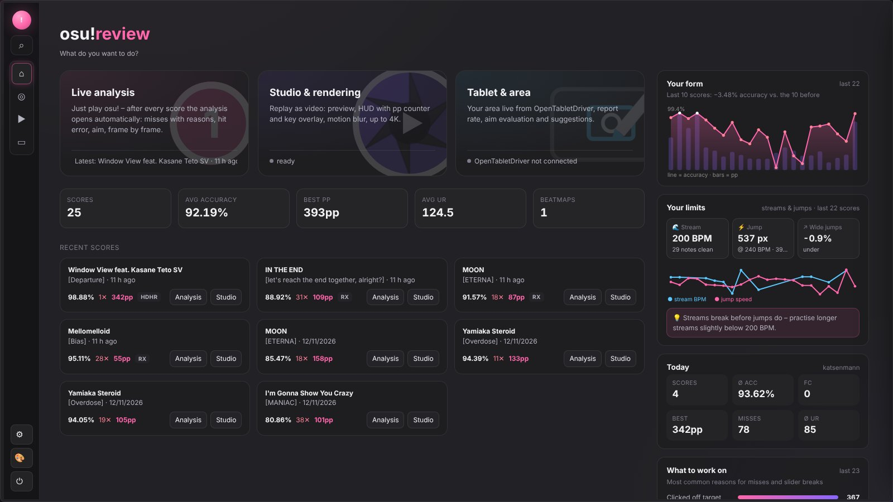
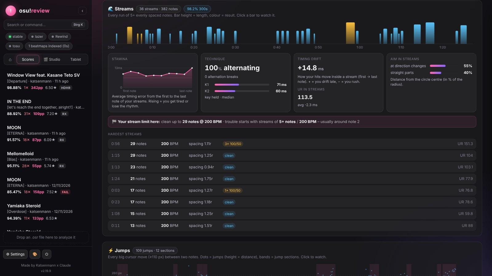

  

<h1 align="center">osu!review</h1>

<b>Replay analysis right after every score.</b> 
Misses with reasons, hit error, aim, streams & jumps, your tablet area – and a studio to render replays as video.

  <a href="https://github.com/katsenmann/osu-review/releases/latest/download/osu-review-Setup.exe"><b>Download for Windows</b></a> (Setup, 12 MB) ·
  <a href="https://katsenmann.github.io/osu-review/">Website</a>

---

## What it does

osu!review runs quietly in the background. As soon as you finish a score in **osu!stable** or **osu!lazer**, the analysis pops up:

- **Miss analyzer** – every miss and slider break with the reason (clicked off target, note lock, too early/late, slider end…), replayed with osu!'s own rules.
- **Replay viewer** – your skin, the song and hitsounds, frame-by-frame, aim lens, cursor path, Hidden toggle.
- **Big view** – live panels next to the playfield: what's happening now, aim on your last jumps, cursor speed, your pen on the tablet, timing of the last hits and a key overlay.
- **Streams & jumps** – stamina curve, timing drift, alternation, over/undershoot by distance and direction, corrections and your stream/jump limits.
- **Tablet & area** – your OpenTabletDriver area live, report rate, and an overall rating of your area from all your replays.
- **Song-select overlay** – your local plays of the selected map right next to osu!'s song select: best acc, pp *if you FC*, your form and this session. In-game (via tosu), in OBS or as a small window, fully customisable – and out of the way while you play or open the mod/beatmap menus.
- **pp** – from tosu or the pp calculator, live. An osu! API key is optional (only for the servers' official value).
- **Studio** – render replays to video with danser-go, with a HUD (pp counter, key overlay), motion blur, up to 4K and 480 FPS.
- **osu!lazer too** – lazer-only maps get their song and background in the replay viewer and can be rendered, offline plays (not logged in) count as yours.
- **Your look** – themes, map backgrounds, colours, fonts, Ctrl+K command bar.

   
  

## Install

**You need:** Windows 10 or 11 and osu! (stable and/or lazer). Nothing else – no Python, no extra downloads by hand.

1. **Download the setup:** [**osu-review-Setup.exe**](https://github.com/katsenmann/osu-review/releases/latest/download/osu-review-Setup.exe) (about 12 MB).
   If your browser asks whether to keep the file, choose **Keep**.
2. **Open it.** Windows will most likely show a blue box saying *"Windows protected your PC"*.
   Click **More info** – only then a **Run anyway** button shows up – and click it.
   Why? osu!review is a free hobby project and isn't signed with a paid certificate, so Windows doesn't know it yet. The whole source code is right here in this repository.
3. **Click through the setup.** It doesn't need admin rights. You can choose a desktop shortcut and whether osu!review should start with Windows (recommended – then it's always ready when you play).
4. **Play osu! as usual.** When you finish a score, the analysis opens by itself.

That's it. osu!review finds your osu! folders on its own. If it ever doesn't, set them in **Settings → osu! folders**.

### Good to know

- **It lives next to the clock.** osu!review keeps running in the background so it can catch your scores – look for the osu!review icon in the tray next to the clock (maybe behind the little **^** arrow). Right-click it to open, check for updates or quit. Closing the window doesn't stop it, *Quit* does.
- **Updates come by themselves.** When there's a new version, osu!review shows a notice with an **Update now** button – one click, your scores and settings stay. You can also check by hand in **Settings → General → Updates**.
- **Failed plays:** osu! doesn't keep a replay when you fail. In osu!stable press **F2** on the game over screen (or turn on **Settings → osu! → Save failed plays automatically** – osu!review does it for you); in osu!lazer click the save button on the fail screen. osu!review then analyses it up to the point where you failed.
- **tosu is built in:** osu!review downloads [tosu](https://github.com/tosuapp/tosu) once and runs it quietly in the background (live pp, failed-play detection). Already running your own tosu? Then that one is used. Off switch: **Settings → pp**.
- **Uninstall:** Windows **Settings → Apps → Installed apps → osu!review → Uninstall**. It asks whether to also delete your analysed scores – say **No** if you might come back.
- **Tablet stats:** need [OpenTabletDriver](https://opentabletdriver.net/). Everything else works without it.

### Something's not right?

| Problem | What to do |
|---|---|
| Windows blocks the setup | Click **More info → Run anyway** (see step 2). Some antivirus programs are extra careful with new programs – allow it there too. |
| Nothing opens after a score | Is osu!review running? Check the tray next to the clock. Then check **Settings → osu! folders**. |
| The window stays empty or grey | Close it and start osu!review again from the Start menu. It needs Microsoft's *WebView2* – already part of Windows 10/11; if it's missing, get it [here](https://developer.microsoft.com/microsoft-edge/webview2/). |
| Anything else | [Open an issue](https://github.com/katsenmann/osu-review/issues) and attach `log.txt` and `window.log` from `%APPDATA%\osu-review` (paste that into the Explorer address bar). |

<b>Without installer (ZIP, for advanced users)</b>

1. Download `osu-review-<version>.zip` from [Releases](https://github.com/katsenmann/osu-review/releases/latest) and unzip it somewhere it can stay.
2. Run `Install.bat` – desktop shortcut and optional autostart. If Python 3 is missing, a small private copy is downloaded into the folder.
3. Remove it again with `Uninstall.bat` (1 = keep scores and settings, 2 = delete everything).

## Data & privacy

Everything stays on your PC: scores and settings live in `%APPDATA%\osu-review`, the app only listens on `127.0.0.1:47290` and only answers its own window (other websites can't use it). Online it only checks GitHub for new versions and downloads the tools it needs (tosu, Node.js and the pp calculators, danser-go for videos) – every download is checked against its published checksum – and, if you set it up, talks to the osu! API. Your API secret is stored encrypted for your Windows account. No telemetry.

## Thanks to

[danser-go](https://github.com/Wieku/danser-go) (video rendering) · [rosu-pp](https://github.com/MaxOhn/rosu-pp) · [tosu](https://github.com/tosuapp/tosu) and its lazer calculator build · [OpenTabletDriver](https://github.com/OpenTabletDriver/OpenTabletDriver) · the osu! team

---

Made by Katsenmann x Claude · not affiliated with ppy / osu!

