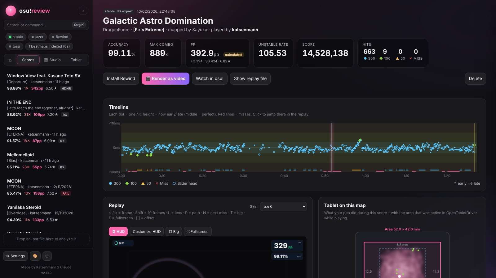
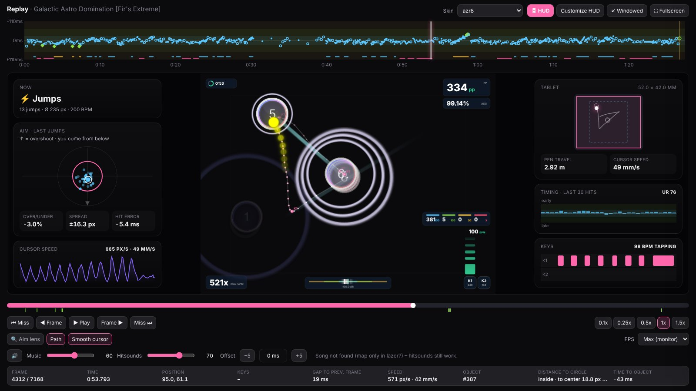

  

<h1 align="center">osu!review</h1>

<b>Replay analysis right after every score.</b> 
Misses with reasons, hit error, aim, streams & jumps, your tablet area – and a studio to render replays as video.

  <a href="https://github.com/katsenmann/osu-review/releases/latest"><b>⬇ Download for Windows</b></a> ·
  <a href="https://katsenmann.github.io/osu-review/">Website</a>

---

## What it does

osu!review runs quietly in the background. As soon as you finish a score in **osu!stable** or **osu!lazer**, the analysis pops up:

- **Miss analyzer** – every miss and slider break with the reason (clicked off target, note lock, too early/late, slider end…), replayed with osu!'s own rules.
- **Replay viewer** – your skin, the song and hitsounds, frame-by-frame, aim lens, cursor path, Hidden toggle.
- **Big view** – live panels next to the playfield: what's happening now, aim on your last jumps, cursor speed, your pen on the tablet, timing of the last hits and a key overlay.
- **Streams & jumps** – stamina curve, timing drift, alternation, over/undershoot by distance and direction, corrections and your stream/jump limits.
- **Tablet & area** – your OpenTabletDriver area live, report rate, and an overall rating of your area from all your replays.
- **pp** – from the osu! API, tosu or osu!lazer's own calculator (current formulas).
- **Studio** – render replays to video with danser-go, with a HUD (pp counter, key overlay), motion blur, up to 4K.
- **Your look** – themes, map backgrounds, colours, fonts, Ctrl+K command bar.

   
  

## Install

1. Download the ZIP from [Releases](https://github.com/katsenmann/osu-review/releases/latest) and unzip it somewhere it can stay (e.g. `Documents\osu-review`).
2. Double-click **`Install.bat`** – creates a desktop shortcut (and optional autostart). Only Python 3 is needed; if it's missing, a small private copy is downloaded into the folder.
3. Start osu!review with the shortcut or `Start.bat`, then just play.

**Update:** run `Uninstall.bat` in the old folder and pick **1** (keeps your scores and settings), then unzip the new version and run `Install.bat` – or simply unzip over the old folder.

**Requirements:** Windows 10/11 · osu!stable and/or osu!lazer · optional: [OpenTabletDriver](https://opentabletdriver.net/), [tosu](https://github.com/tosuapp/tosu)

## Data & privacy

Everything stays on your PC: scores and settings live in `%APPDATA%\osu-review`, the app only listens on `127.0.0.1:47290`. Online it only downloads the tools it needs (Python if missing, Node.js and the pp calculators, danser-go) and, if you set it up, talks to the osu! API.

## Thanks to

[danser-go](https://github.com/Wieku/danser-go) (video rendering) · [rosu-pp](https://github.com/MaxOhn/rosu-pp) · [tosu](https://github.com/tosuapp/tosu) and its lazer calculator build · [OpenTabletDriver](https://github.com/OpenTabletDriver/OpenTabletDriver) · the osu! team

---

Made by Katsenmann x Claude · not affiliated with ppy / osu!

